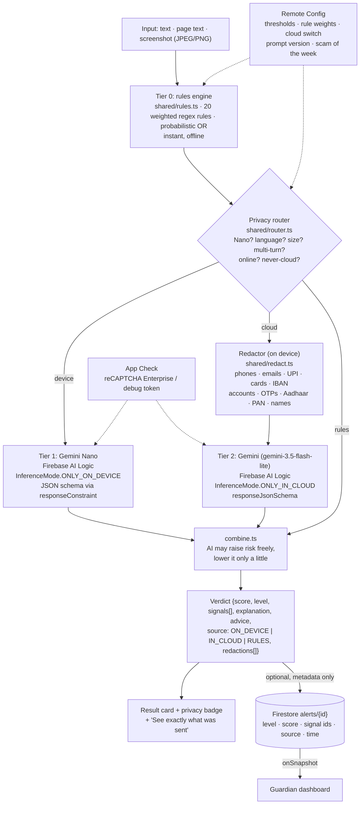

# SecondLook

[](https://github.com/im-Amrith/secondlook/actions/workflows/ci.yml)

**Scam checks that run on your device first.** SecondLook reads a suspicious message, web page or screenshot with **Gemini Nano on your own device** through the **Firebase AI Logic hybrid SDK**. It falls back to the cloud only after removing personal details, and it always shows you which path ran. If something is serious, it can tell a family member you trust, with the warning signs only and never your messages.

Built for the Firebase **#BuildHybridAI** hackathon. Platforms: **Web (Chrome)** and a **Chrome extension**; Android is planned as a thin companion.

## The problem

- India lost about **₹4,057 crore to "digital arrest" scams** between 2022 and May 2026, across roughly 297k complaints. Older people are hit hardest.
- Families keep asking the same question: *how do we protect Mom without reading her messages?*
- Blocklists and known-scam databases miss the **pattern**: fake authority, urgency, isolation ("don't tell your family", "stay on the call"), then a money request.
- Nobody should have to upload their private chats to a cloud AI to find out whether they're being scammed. **That is the honest reason to run on-device.**

## What it does

| Surface | You do | SecondLook does |
|---|---|---|
| **Web app** | Paste a message or add a screenshot | Rules check instantly, then Gemini Nano on your device (or redacted cloud fallback). Plain-language verdict, the warning signs it found, what to do now. |
| **Chrome extension** | Select text in WhatsApp Web or Gmail → right-click → *Check with SecondLook* | Same check in the side panel. A warning banner appears on look-alike login and payment pages. |
| **Call Guard** | Put a suspicious call on speaker (or tap a few yes/no questions) | Listens **on the device** and shows a big *Hang up now* warning the moment it hears "digital arrest", "don't tell your family", "move your money to a safe account"… Call audio is never sent anywhere. |
| **Pause before paying** | Open a bank-transfer or send-money page, or tap *Take a 1-minute pause* | A countdown, four honest questions, and one big button to call someone you trust. |
| **Practise** | Pick a practice call | A safe, scripted scam call where you choose replies and learn each trick, or a free chat where Gemini Nano plays the scammer on your device. |
| **Scam radar** | Tap *Add to the scam radar* on a scam result; open the radar | Weekly counts of scam *types* per state ("Digital arrest calls: 37 this week, 12 in Kerala"). Only the type, week and state are shared, never the message. |
| **Family circle** | Link someone you trust | On a risky result you can send *"Dad: 3 scam signals (fake authority, urgency, money request), 2 min ago"*. **No message text is ever stored or shared.** |

### The visible privacy router

Every result carries a badge, so "private AI" is something you can check rather than a promise:

- 🟢 **Checked on this device.** Nothing was sent anywhere. (`response.inferenceSource === "on_device"`)
- 🔵 **Checked in the cloud, with personal details removed:** e.g. *3 phone numbers, 1 account number and 2 names*. Tap **See exactly what was sent** to read the redacted text word for word.
- ⚪ **Quick check:** rules only, because no AI model was available.

Under the badge, one sentence from the router says *why* that path was chosen. The router is visible in three more places:

- **Before you check:** as you type, a line under the box says where the check *will* run (e.g. *"Hindi detected: will remove personal details, then check in the cloud"*).
- **Follow-up questions** ("I already paid. What now?") are multi-turn, which the on-device model can't do, so they go to the cloud with the original message and the question redacted together, with the same badge and "what was sent" view. With the cloud off they're answered on device as a fresh question.
- **The Privacy page** runs the real router against *this device's* current state for typical cases (short text, screenshot, Hindi, long chat, follow-up, offline) and lists exactly what leaves the device on each path.

### Call Guard: warnings while the call is still going on

"Digital arrest" and bank-fraud scams happen **live**: a fake officer keeps someone on a video call for hours until they transfer their savings. A checker you paste a message into comes too late, so SecondLook also works *during* the call (**On a call** in the menu, and a banner on the check screen):

- **Put the call on speaker and press *Start listening*.** Speech is recognised **on the device**. For **Hindi and Malayalam** (and English when Chrome has no speech pack), it uses **Whisper**, an open multilingual model from Hugging Face run by Transformers.js in a Web Worker: WebGPU when available, WASM otherwise, a one-time download after the person agrees, then it works offline. Chrome's own on-device Web Speech (`processLocally: true`) streams English words when available, and Gemini Nano audio is the last resort. Hindi uses a Hindi fine-tune of Whisper small; for Malayalam, stock Whisper's transcripts are unusable, so it translates the call into English and the English rules read that (it still reaches "hang up" on the test call). [evals/ASR.md](evals/ASR.md) measures whether spoken Hindi and Malayalam scam calls still reach "hang up". As the caller talks, the rules run on every phrase, and a big warning appears the moment a scam pattern shows up: *"⛔ Hang up now. There is no such thing as a 'digital arrest'…"*, in English, Hindi or Malayalam, with **Read aloud**. Signals stay on screen after the words scroll past, with the exact phrase that triggered them.
- **Call audio never goes to the cloud.** There is no cloud path in the code (`web/src/lib/listen.ts`). If neither on-device engine is available, listening stays off and says why. We also refuse to start Chrome's recogniser unless it confirms `processLocally`, because the default Web Speech API sends audio to a server. The words live only in the page's memory and disappear when you leave.
- **With Gemini Nano**, the private model gives a second opinion on the conversation every ~15 s, again on the device only.
- **No microphone? Tap instead.** Six yes/no questions ("Did they tell you not to tell your family?") feed the same warning, and you can type what they said.
- **Then act:** one big **📞 Call [your trusted person]** button (name and number saved only on this device), **📞 1930**, *Let my family know*, and the pause screen below.
- **Demo mode:** *Watch a demo call* plays a made-up digital-arrest call line by line (clearly labelled, no microphone), so the feature can be shown anywhere.

Firebase AI Logic 13.3's on-device adapter converts every `inlineData` part to an image, so audio can't go through the SDK yet. The Nano audio path calls Chrome's Prompt API directly, which is on-device by definition.

### Pause before paying

Scams work by rushing people, so SecondLook adds friction at the moment of payment:

- **A 1-minute pause screen** (`#/pause`, linked from every medium/high result and from Call Guard): a countdown, four honest questions (*"Is someone on the phone telling you to make this payment?"*), and if any answer is yes, *"Please don't pay. This is how scams work."* with the specific reason, the call button and the family alert.
- **In the extension**, a gentle banner appears on bank-transfer, add-payee, UPI send-money and gift-card pages (`shared/src/payment.ts`; shopping checkouts are deliberately ignored): *"✋ About to send money? Is someone on the phone or a video call telling you to do this?"* Answering yes shows *"Please stop. Don't pay."* and can open the pause screen in the side panel. Detected locally; nothing is sent.

### Practise saying no

Teaching people a scam's tricks *before* they meet them ("prebunking") works better than warning them afterwards. **Practise** (`#/practice`) has short, safe practice calls: a fake CBI officer, a "your bank account will be blocked" message, and a "Hi Ma, this is my new number" chat. At each line you pick a reply; SecondLook names the trick ("Secrecy", "A 'safe account'") and explains why it works on people. At the end: *"You spotted 3 of 4 tricks"* and three things to remember, read aloud if you like. Scripted, so it works offline in English, Hindi and Malayalam, and every scammer line in the CBI and KYC calls is one the rules engine flags.

**Free practice with the private AI:** with Gemini Nano available, the on-device model plays the scam caller (`ONLY_ON_DEVICE` through Firebase AI Logic) and you type replies. Each caller message shows the tricks the rules engine finds in it, and saying no firmly ("I'm hanging up and calling my son") wins. Your replies never leave the device.

### Scam radar: warn others without sharing anything private

**Scam radar** (`#/radar`, linked from the check screen) shows which kinds of scam people are reporting this week, across India or in one state: *"Digital arrest / fake police calls: 37 this week (12 in Kerala), last week 9 ↑"*. The check screen shows the top one.

- On a medium/high result (or in Call Guard), **📡 Add to the scam radar** is one tap. **The device** works out the *type* of scam from the rules that fired (`classifyPattern` in `shared/src/radar.ts`: digital arrest, bank/KYC, electricity, job/task, prize, investment, "new number" family emergency, romance, other). It then adds 1 to a Firestore counter for `{ISO week, type, state}`. The state is optional and set in Settings.
- **No message, excerpt, score, user id or exact time is ever written.** `firestore.rules` allows only those five fields, a fixed list of types and regions, a document id that matches them, creating a counter at 1 and adding exactly 1. Nobody can delete or reset a counter. Rules tests cover this (`web/rules-test`).
- Counts come from SecondLook users, not official figures, and the page says so. Writes are public, so App Check enforcement is what keeps them to the real app.

### Read aloud, on the device

Every result and follow-up answer has a big **🔊 Read aloud** button (and an "always read results aloud" setting), because many older people find a spoken verdict easier than small text. The voices are open-source models from Hugging Face running **in the browser** (ONNX Runtime Web in a Web Worker), so the text is never sent anywhere to be spoken:

| Language | Default voice (fast) | Also available | Intelligibility (Whisper CER) |
|---|---|---|---|
| English | Piper `en_US-ljspeech-medium` (public-domain data) | Piper Kristin | 2.7% |
| Hindi | Piper `hi_IN-priyamvada-medium` | Piper Rohan | 10.8% |
| Malayalam | Piper `ml_IN-meera-medium` | Piper Arjun | 38.6% (mostly Whisper's own Malayalam errors) |

Text goes through espeak-ng (compiled to WASM) into phonemes, then a Piper VITS model. Only Piper is shipped because speed matters most: it ran about 4x faster than real time on one WASM thread. Kokoro-82M was tested and sounded more natural, but ran 2.6x to 10x *slower* than real time, so it was dropped. Each voice downloads once (about 60 MB plus 30 MB shared) after the person agrees. If no voice is downloaded, the device's own **local** voice is used; network voices such as Chrome's "Google हिन्दी" are skipped because they send the text to a server. Mixed results (a Hindi verdict with an English AI explanation) switch voice per sentence. The Hindi and Malayalam Piper voices are trained on **non-commercial** datasets; Settings marks them. Method, numbers and samples: [evals/TTS.md](evals/TTS.md).

**Nano helps even when the cloud runs.** When a check must go to the cloud but Gemini Nano is on the device (Hindi text, very long chats, follow-ups), the on-device model first lists people's names so they're masked along with the regex redactions.

## Routing rules

The router (`shared/src/router.ts`) is a pure function that runs **before** any model call, so text can be redacted before anything leaves the device. Each row has a unit test.

| Condition | Route | Reason |
|---|---|---|
| Nano available, English (or romanised Hinglish), fits on device, text or JPEG/PNG | **On-device** | Private, free, works offline |
| Hindi or Malayalam script | **Redact → cloud** | The on-device models aren't validated for these languages (Chrome: en/es/ja; Android: en/ko) |
| Long text (over ~8.5k tokens on web, ~3.3k on Android, after prompt overhead) | **Chunk on-device** (up to 3 parts); if still too big, **redact → cloud** | On-device token limits (9,216 web / 4,000 Android) |
| Follow-up question (multi-turn) | **Redact → cloud** | On-device is single-turn |
| No Nano (older Chrome, unsupported device) | **Redact → cloud** | Fallback |
| Offline and no Nano | **Rules only** | Always gives an answer |
| User turned on **Never use the cloud** (or Remote Config switches the cloud off) | **Device or rules only** | User control |
| Screenshot and no Nano | **Ask first**, then cloud | Pictures can't be redacted by regex, so the user decides |
| On-device call fails | **Redact → cloud**, else rules | Graceful fallback, explained in the UI |

## Architecture



**SDK use.** Two models from one `getAI(app, { backend: new GoogleAIBackend() })`: one with `InferenceMode.ONLY_ON_DEVICE` and one with `InferenceMode.ONLY_IN_CLOUD` (`web/src/lib/ai.ts`). The router picks between them so it can redact *before* the cloud. A third model with `PREFER_ON_DEVICE` is used where the SDK's own choice is fine. The badge reads `response.inferenceSource` rather than assuming. `initializeDeviceModel()` is called from the onboarding button click (it needs a user gesture).

Notes from the installed typings (`firebase@13.3.0`) that differ from older docs: `InferenceSource` values are lowercase (`"on_device"`, `"in_cloud"`); the on-device adapter ignores `systemInstruction`, so the system prompt goes in `onDeviceParams.createOptions.initialPrompts`; inline image parts need `type: "inlineData"`; the cloud model takes plain JSON Schema through `generationConfig.responseJsonSchema`. Text and image availability are checked separately (a Chrome can run Nano on text without multimodal input), and the on-device JSON constraint drops length/range keywords.

**A privacy pitfall we found and guard against.** In `firebase@13.3.0`, an `ONLY_ON_DEVICE` model only gets its on-device adapter if Chrome's `LanguageModel` exists at the moment `getGenerativeModel()` runs (and never in the SDK's Node build). Without it, `generateContent()` quietly sends the request **to the cloud**, unredacted, despite the mode. SecondLook's on-device runners are created lazily only when the Prompt API is present, re-check before every call, and reject any answer whose `inferenceSource` isn't `on_device`. This matters most for the Nano name-finder, which sees unredacted text. Contract tests drive the real SDK with a fake Prompt API and a stubbed `fetch` to prove no request leaves (`web/test/sdk-contract.test.ts`).

### Firebase products

| Product | Job |
|---|---|
| **AI Logic** | Hybrid inference: Gemini Nano on device, Gemini in the cloud |
| **App Check** | reCAPTCHA Enterprise on the web; debug provider in development and in the extension (reCAPTCHA can't load in MV3) |
| **Authentication** | Google sign-in for the family circle: popup on the web, `chrome.identity` → `signInWithCredential` in the extension (with `firebase/auth/web-extension`) |
| **Firestore** | `circles/{id}` (members) and `alerts/{id}` (metadata only). `firestore.rules` allow-lists alert fields, so message text can't be stored even by a modified client. **8 rules tests pass in the Firestore emulator** (`npm run test:rules`) |
| **Remote Config** | Risk thresholds, per-rule weight overrides, cloud on/off switch, cloud model, prompt version, live extra rules and a "scam of the week" banner (`remoteconfig.template.json`) |
| **Hosting** | The web app and family dashboard (`firebase.json`) |

The Firebase SDK is loaded lazily, only when a config exists: the first screen is 90 KB gzipped. The web app is an installable **PWA** whose service worker keeps the app shell available offline (it never caches API calls), so quick checks and Gemini Nano keep working with no connection.

### Made for older people

- Large type (20 px base, an *Extra large text* switch), high contrast in light and dark mode, 52–60 px tap targets, plain words, one clear "What to do" line on every result.
- **Hindi and Malayalam UI** for the core flow (language buttons on the welcome screen and in Settings). Rule-based advice, warning signs, badges and router reasons are translated; cloud answers come back in the person's language. The on-device model only answers in English, so the app says when an AI explanation is in English. Translations are first drafts awaiting native review.
- No horizontal scrolling at 375 px, and **axe-core** accessibility tests on the main screens (`web/test/a11y.test.tsx`).

### Scam of the week (Remote Config)

Push a new pattern to every user without a release, e.g. in the Remote Config console set `extra_rules` to:

```json
[{ "id": "fastag", "category": "link", "label": "Fake FASTag renewal", "why": "NHAI never asks you to renew FASTag through a link in a message.", "weight": 0.5, "pattern": "fastag.{0,40}(renew|expire|kyc|block)" }]
```

and `scam_of_the_week` to *"Fake FASTag renewal messages are going around"*. The next check picks it up: *"Your FASTag will be blocked today. Renew KYC now at fastag-renew.top"* scores **0** with the built-in rules and **50 (Be careful)** once the rule is live.

## Repository layout

```
shared/     rules, verdict schema, redactor, prompt, router, combiner, check pipeline, URL scorer,
            call guard (live transcript + questions), payment-page detector, scam radar (all unit-tested)
web/        Vite + React app: check, onboarding/model download, privacy page, settings, family circle, guardian alerts, #/evals
            rules-test/ Firestore security rules tests (emulator)
extension/  Chrome MV3: side panel (reuses the web UI), right-click check, look-alike page banner,
            pause banner on payment pages, chrome.identity sign-in
            src/lib/tts/ read-aloud: voice catalogue, phonemizer, Piper engine, Web Worker, player
            src/lib/listen.ts on-device speech for Call Guard (Web Speech processLocally, Nano audio, demo)
evals/      labelled datasets (scam + redaction), runner, RESULTS.md, TTS.md (voice intelligibility + speed),
            ASR.md (Call Guard speech recognition in en/hi/ml)
scripts/    tts-samples.mts (WAV for every voice, in Node), tts-eval.mts (Whisper round-trip check)
firebase.json, firestore.rules, firestore.indexes.json, remoteconfig.template.json
```

## Eval results

84 labelled messages: 52 from shield-paypal-ai's sets plus 32 new ones (digital arrest, courier/customs, KYC/bank block, electricity cut-off, task jobs, romance, family impersonation and benign look-alikes, in English, Hinglish, Manglish and Devanagari Hindi). A message counts as flagged at medium or high.

| Scorer | N | Precision | Recall | Accuracy | F1 | Median latency |
|---|---|---|---|---|---|---|
| Rules only (Tier 0) | 84 | 96% | 94% | 94% | 95% | <1 ms |
| Gemini Nano (on device) | *pending: run `#/evals` in Chrome with Nano* | | | | | |
| Gemini cloud (redacted) | *pending: needs Firebase project* | | | | | |

The new cases were written alongside the new rules, so rules-only numbers on that set are optimistic; the remaining misses (a fake India Post redelivery link, a fake Amazon "illegal orders" call, a Hinglish electricity cut-off, and two benign false alarms) are left in on purpose as the cases the AI tiers should fix. Full breakdown by dataset, category and language: [evals/RESULTS.md](evals/RESULTS.md).

**Redaction** (the privacy claim, measured): on 22 messages with 26 labelled identifiers (phones, UPI IDs, accounts, cards, IBAN, OTPs, Aadhaar, PAN, emails, names), `redact()` removed **26/26** and kept **41/41** phrases the model still needs (amounts, times, scam words). The first run leaked 2; both gaps were fixed and are noted in RESULTS.md. Names are only caught after titles and introductions for now.

**Extension banner:** on 36 hand-written login-page URLs (18 look-alikes in common Indian phishing styles, 18 real bank/shop/government sites), the local URL rules warned on all 18 look-alikes and on none of the real sites, after one fix the eval found (Microsoft's real `login.microsoftonline.com` was flagged). Small and hand-written, so treat it as a sanity check rather than a benchmark.

To add the AI rows: open the web app at `#/evals` in Chrome, run on-device and cloud, download each predictions file, then:

```bash
npm run evals -- --recorded device=predictions-device.json --recorded cloud=predictions-cloud.json --write
```

**Read-aloud voices:** each voice says the same scam warning, Whisper large-v3-turbo transcribes it back, and we score the character error rate. Results and browser speed are in [evals/TTS.md](evals/TTS.md); `npm run tts:samples` writes the WAV files to `tts-samples/` so you can listen.

## Setup

Requirements: Node 20+ (tested on Node 26), desktop Chrome 139+ for Gemini Nano.

```bash
npm install
npm test            # shared, evals, web (incl. SDK contract + a11y) and extension tests
npm run build       # typecheck + web build + extension build
npm run dev         # web app on http://localhost:5173
npm run evals       # eval tables (add -- --write to update evals/RESULTS.md)
npm run test:rules  # Firestore rules tests in the emulator (needs Java)
```

The Firebase CLI crashes on Node 26, so the `test:rules`, `emulators` and `deploy` scripts run it under Node 22 through `npx -p node@22`. On Windows, if the Firestore emulator fails with *"Unable to establish loopback connection"*, set `JAVA_TOOL_OPTIONS=-Djdk.net.unixdomain.tmpdir=C:\tmp` (a folder with no spaces).

With no Firebase config the app runs in **rules-only mode** and says so. To turn on AI:

1. Create a Firebase project and register a web app.
2. In **AI Logic**, enable the **Gemini Developer API**.
3. Copy `web/.env.example` to `web/.env.local` and fill in the `VITE_FIREBASE_*` values (the extension reads the same file).
4. **App Check**: create a reCAPTCHA Enterprise key for your domains, set `VITE_RECAPTCHA_ENTERPRISE_SITE_KEY`, and register the debug token printed in the browser console during `npm run dev`.
5. Enable **Authentication → Google** and create a **Firestore** database; deploy `firestore.rules` and `firestore.indexes.json`.
6. For Gemini Nano in development, enable `chrome://flags/#prompt-api-for-gemini-nano-multimodal-input`, then use **Download the private model** in the app.

Developer mode: `npm run dev` then open `http://localhost:5173/?mockNano` to exercise the on-device path with a clearly labelled simulated model (dev builds only).

**Chrome extension:** `npm run build`, then `chrome://extensions` → Developer mode → **Load unpacked** → `extension/dist`. For family sign-in inside the extension, create an OAuth client of type *Chrome extension* for its id and set `VITE_GOOGLE_OAUTH_CLIENT_ID` (and optionally `VITE_EXTENSION_KEY` to pin the id) before building.

**Deploy** (Hosting, Firestore rules/indexes, Remote Config template): `npm run deploy`.

## Built during the contest vs reused

- **Reused:** the 16 weighted scam rules, the probabilistic-OR scoring and the two eval sets from [shield-paypal-ai](https://github.com/im-Amrith/shield-paypal-ai) (rules made generic, not PayPal-specific); the extension shell idea (manifest, navigation hook, warning-banner content script, URL features) from [PhishShield_Extension](https://github.com/im-Amrith/PhishShield_Extension).
- **New in the contest period:** everything hybrid and on-device (Firebase AI Logic integration, privacy router, redactor, Nano-assisted name masking, visible badge, route preview, "what was sent" drawer, follow-up questions, privacy page), the secrecy / digital-arrest / account-block rules, the 32 new eval cases, the redaction eval and the runner, the web app, the MV3 side-panel extension and local URL scorer, the family circle and its security rules tests, Remote Config and App Check wiring.

## License

[Apache-2.0](LICENSE)
