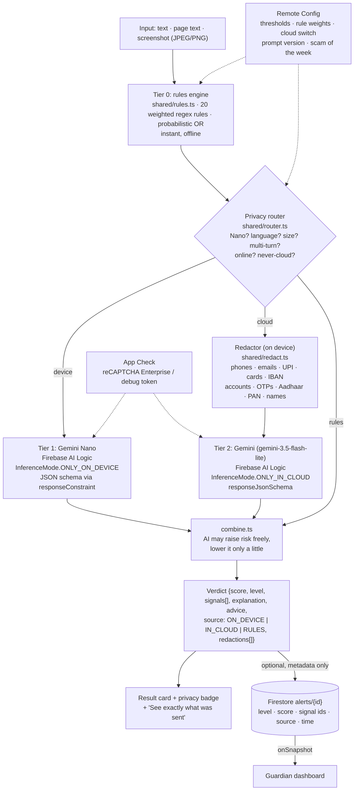

# SecondLook

**Scam checks that run on your device first.** SecondLook reads a suspicious message, web page or screenshot with **Gemini Nano on your own device** through the **Firebase AI Logic hybrid SDK**. It falls back to the cloud only after removing personal details, and it always shows you which path ran. If something is serious, it can tell a family member you trust, with the warning signs only and never your messages.

Built for the Firebase **#BuildHybridAI** hackathon. Platforms: **Web (Chrome)** and a **Chrome extension**; Android is planned as a thin companion.

## The problem

- India lost about **₹4,057 crore to "digital arrest" scams** between 2022 and May 2026, across roughly 297k complaints. Older people are hit hardest.
- Families keep asking the same question: *how do we protect Mom without reading her messages?*
- Blocklists and known-scam databases miss the **pattern**: fake authority, urgency, isolation ("don't tell your family", "stay on the call"), then a money request.
- Nobody should have to upload their private chats to a cloud AI to find out whether they're being scammed. **That is the honest reason to run on-device.**

## What it does

| Surface | You do | SecondLook does |
|---|---|---|
| **Web app** | Paste a message or add a screenshot | Rules check instantly, then Gemini Nano on your device (or redacted cloud fallback). Plain-language verdict, the warning signs it found, what to do now. |
| **Chrome extension** | Select text in WhatsApp Web or Gmail → right-click → *Check with SecondLook* | Same check in the side panel. A warning banner appears on look-alike login and payment pages. |
| **Family circle** | Link someone you trust | On a risky result you can send *"Dad: 3 scam signals (fake authority, urgency, money request), 2 min ago"*. **No message text is ever stored or shared.** |

### The visible privacy router

Every result carries a badge, so "private AI" is something you can check rather than a promise:

- 🟢 **Checked on this device.** Nothing was sent anywhere. (`response.inferenceSource === "on_device"`)
- 🔵 **Checked in the cloud, with personal details removed:** e.g. *3 phone numbers, 1 account number and 2 names*. Tap **See exactly what was sent** to read the redacted text word for word.
- ⚪ **Quick check:** rules only, because no AI model was available.

Under the badge, one sentence from the router says *why* that path was chosen.

## Routing rules

The router (`shared/src/router.ts`) is a pure function that runs **before** any model call, so text can be redacted before anything leaves the device. Each row has a unit test.

| Condition | Route | Reason |
|---|---|---|
| Nano available, English (or romanised Hinglish), fits on device, text or JPEG/PNG | **On-device** | Private, free, works offline |
| Hindi or Malayalam script | **Redact → cloud** | The on-device models aren't validated for these languages (Chrome: en/es/ja; Android: en/ko) |
| Long text (over ~8.5k tokens on web, ~3.3k on Android, after prompt overhead) | **Chunk on-device** (up to 3 parts); if still too big, **redact → cloud** | On-device token limits (9,216 web / 4,000 Android) |
| Follow-up question (multi-turn) | **Redact → cloud** | On-device is single-turn |
| No Nano (older Chrome, unsupported device) | **Redact → cloud** | Fallback |
| Offline and no Nano | **Rules only** | Always gives an answer |
| User turned on **Never use the cloud** (or Remote Config switches the cloud off) | **Device or rules only** | User control |
| Screenshot and no Nano | **Ask first**, then cloud | Pictures can't be redacted by regex, so the user decides |
| On-device call fails | **Redact → cloud**, else rules | Graceful fallback, explained in the UI |

## Architecture



**SDK use.** Two models from one `getAI(app, { backend: new GoogleAIBackend() })`: one with `InferenceMode.ONLY_ON_DEVICE` and one with `InferenceMode.ONLY_IN_CLOUD` (`web/src/lib/ai.ts`). The router picks between them so it can redact *before* the cloud. A third model with `PREFER_ON_DEVICE` is used where the SDK's own choice is fine. The badge reads `response.inferenceSource` rather than assuming. `initializeDeviceModel()` is called from the onboarding button click (it needs a user gesture).

Notes from the installed typings (`firebase@13.3.0`) that differ from older docs: `InferenceSource` values are lowercase (`"on_device"`, `"in_cloud"`); the on-device adapter ignores `systemInstruction`, so the system prompt goes in `onDeviceParams.createOptions.initialPrompts`; inline image parts need `type: "inlineData"`; the cloud model takes plain JSON Schema through `generationConfig.responseJsonSchema`.

### Firebase products

| Product | Job |
|---|---|
| **AI Logic** | Hybrid inference: Gemini Nano on device, Gemini in the cloud |
| **App Check** | reCAPTCHA Enterprise on the web; debug provider in development and in the extension |
| **Authentication** | Google sign-in for the family circle |
| **Firestore** | `circles/{id}` (members) and `alerts/{id}` (metadata only). `firestore.rules` allow-lists alert fields, so message text can't be stored even by a modified client |
| **Remote Config** | Risk thresholds, per-rule weight overrides, cloud on/off switch, prompt version, live extra rules ("scam of the week") |
| **Hosting** | The web app and family dashboard (`firebase.json`) |

## Repository layout

```
shared/     rules, verdict schema, redactor, prompt, router, combiner, check pipeline, URL scorer (all unit-tested)
web/        Vite + React app: check, onboarding/model download, settings, family circle, guardian alerts, #/evals
extension/  Chrome MV3: side panel (reuses the web UI), right-click check, look-alike page banner
evals/      labelled datasets, runner, RESULTS.md
firebase.json, firestore.rules, firestore.indexes.json
```

## Eval results

84 labelled messages: 52 from shield-paypal-ai's sets plus 32 new ones (digital arrest, courier/customs, KYC/bank block, electricity cut-off, task jobs, romance, family impersonation and benign look-alikes, in English, Hinglish, Manglish and Devanagari Hindi). A message counts as flagged at medium or high.

| Scorer | N | Precision | Recall | Accuracy | F1 | Median latency |
|---|---|---|---|---|---|---|
| Rules only (Tier 0) | 84 | 96% | 94% | 94% | 95% | <1 ms |
| Gemini Nano (on device) | *pending: run `#/evals` in Chrome with Nano* | | | | | |
| Gemini cloud (redacted) | *pending: needs Firebase project* | | | | | |

The new cases were written alongside the new rules, so rules-only numbers on that set are optimistic; the remaining misses (a fake India Post redelivery link, a fake Amazon "illegal orders" call, a Hinglish electricity cut-off, and two benign false alarms) are left in on purpose as the cases the AI tiers should fix. Full breakdown by dataset, category and language: [evals/RESULTS.md](evals/RESULTS.md).

**Redaction** (the privacy claim, measured): on 22 messages with 26 labelled identifiers (phones, UPI IDs, accounts, cards, IBAN, OTPs, Aadhaar, PAN, emails, names), `redact()` removed **26/26** and kept **41/41** phrases the model still needs (amounts, times, scam words). The first run leaked 2; both gaps were fixed and are noted in RESULTS.md. Names are only caught after titles and introductions for now.

To add the AI rows: open the web app at `#/evals` in Chrome, run on-device and cloud, download each predictions file, then:

```bash
npm run evals -- --recorded device=predictions-device.json --recorded cloud=predictions-cloud.json --write
```

## Setup

Requirements: Node 20+ (tested on Node 26), desktop Chrome 139+ for Gemini Nano.

```bash
npm install
npm test          # shared, evals, web and extension tests
npm run build     # typecheck + web build + extension build
npm run dev       # web app on http://localhost:5173
```

With no Firebase config the app runs in **rules-only mode** and says so. To turn on AI:

1. Create a Firebase project and register a web app.
2. In **AI Logic**, enable the **Gemini Developer API**.
3. Copy `web/.env.example` to `web/.env.local` and fill in the `VITE_FIREBASE_*` values (the extension reads the same file).
4. **App Check**: create a reCAPTCHA Enterprise key for your domains, set `VITE_RECAPTCHA_ENTERPRISE_SITE_KEY`, and register the debug token printed in the browser console during `npm run dev`.
5. Enable **Authentication → Google** and create a **Firestore** database; deploy `firestore.rules` and `firestore.indexes.json`.
6. For Gemini Nano in development, enable `chrome://flags/#prompt-api-for-gemini-nano-multimodal-input`, then use **Download the private model** in the app.

Developer mode: `npm run dev` then open `http://localhost:5173/?mockNano` to exercise the on-device path with a clearly labelled simulated model (dev builds only).

**Chrome extension:** `npm run build`, then `chrome://extensions` → Developer mode → **Load unpacked** → `extension/dist`.

## Built during the contest vs reused

- **Reused:** the 16 weighted scam rules, the probabilistic-OR scoring and the two eval sets from [shield-paypal-ai](https://github.com/im-Amrith/shield-paypal-ai) (rules made generic, not PayPal-specific); the extension shell idea (manifest, navigation hook, warning-banner content script, URL features) from [PhishShield_Extension](https://github.com/im-Amrith/PhishShield_Extension).
- **New in the contest period:** everything hybrid and on-device (Firebase AI Logic integration, privacy router, redactor, visible badge, "what was sent" drawer), the secrecy / digital-arrest / account-block rules, the 32 new eval cases and runner, the web app, the MV3 side-panel extension and local URL scorer, the family circle, Remote Config and App Check wiring.

## License

[Apache-2.0](LICENSE)
